# Working Sprint 1 and Verification

All evidence in this part was produced from release `v0.1.0-sprint1` — merge commit `bfd125f` on `main`, tested on staging commit `2bafb18` (identical file tree). Release notes (end of this part) name `3ed2771`, the earlier head of `staging/sprint-1`; the only changes from `3ed2771` to `2bafb18` are documentation and recorded test output, and every result in this report was recorded on `2bafb18`. Screenshots were taken on 15 November 2026 from the release code running locally (Vite dev server on :5173, Express API on :3000, PostgreSQL 18) with the seeded synthetic accounts. No password is shown.

## F.1 Setup summary (reproduction)

| Step | Command / content |
|---|---|
| Prerequisites | Node.js 24, npm 10+, PostgreSQL 16+ (we used 18) |
| Databases | Create a role and two databases (`habittracker`, `habittracker_test`) — README §3 |
| Environment | `cp server/.env.example server/.env`; set `DATABASE_URL`, `DATABASE_URL_TEST`, `SESSION_TTL_HOURS`, `TZ=Asia/Bangkok`, `SEED_MANAGER_PASSWORD`, `SEED_PARTICIPANT_PASSWORD` (placeholders only in Git) |
| Install | `npm install`; `cd server && npm install && cd ..` (also runs `prisma generate`); `cd client && npm install && cd ..`; `npx playwright install chromium` |
| Database | `npm run migrate` · `npm run migrate:test` · `npm run seed` |
| Run | `npm run dev:server` (API on :3000) and `npm run dev:client` (UI on :5173 with `/api` proxy) |
| Test | `npm test` (server + client + E2E) · `npm run test:restart` (NFR-04) · `npm run build` |
| Test accounts | Seeded synthetic accounts `manager@example.test`, `participant@example.test`, `participant2@example.test`; passwords come only from the local `server/.env` (never in Git or this report) |

**Clean-clone check (NFR-06):** performed by Nitithorn, who did not write the README, on commit `19c33fa` from an empty test database following only the README: install, migrate, seed, server 63 / client 34 / E2E 1 passed, restart check and build passed — 74 s, excluding the initial database provisioning. Two earlier runs failed (missing `prisma generate`, `migrate dev` needing CREATEDB, test database not migrated, Prisma client generated into the wrong folder); each failure was reported in PR #31 and fixed before approval.

## F.2 Program demonstrations

### Scenario 1 — Normal domain journey and retrieval of the saved result

| | |
|---|---|
| Features / AC | F-01 (AC-01), F-03 (AC-12), F-04 (AC-17), F-05 (AC-24) |
| Role | Participant (`participant@example.test`, "Alex Student") |
| Start | Seeded database; the participant has no goals; template "Daily Reading" (1–200 pages) is published |
| Steps | Sign in → Templates → *Set goal* 20 pages → Goals → log 25 pages for today → reload the page |
| Expected | Goal saved; entry saved; 125 % and "Achieved"; after reload the entry and progress are still shown (read back from PostgreSQL) |
| Actual | As expected (screens 1a–1e) |

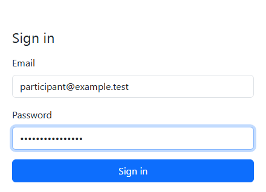

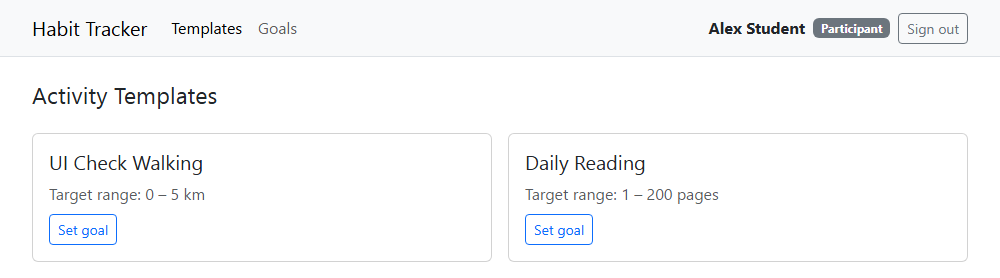

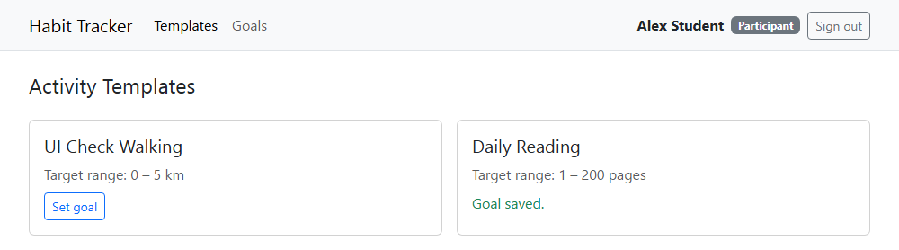

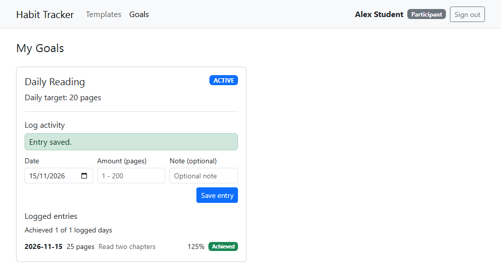

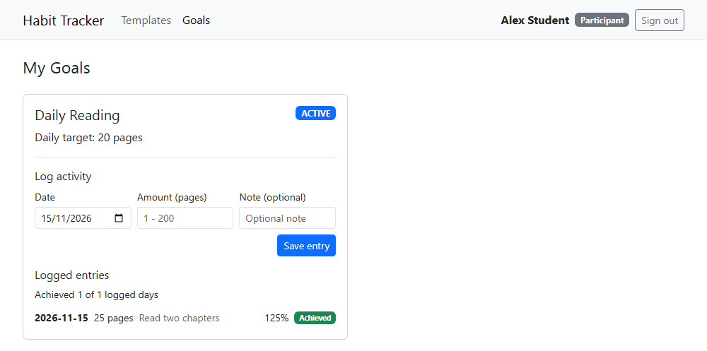

### Scenario 2 — Business-rule rejections

| | |
|---|---|
| Features / AC | F-04: AC-21 (one entry per goal per day, BR-04), AC-18 (value within range, BR-01) |
| Role | Participant (same session as Scenario 1) |
| Start | The goal already has an entry for today |
| Steps | Submit 30 pages for the same date; then submit 300 pages |
| Expected | 409 `DUPLICATE_ENTRY` with message; 422 `VALUE_OUT_OF_RANGE` naming the allowed range; nothing new stored |
| Actual | As expected (screens 2a–2b); the entries list still shows only the 25-page entry |

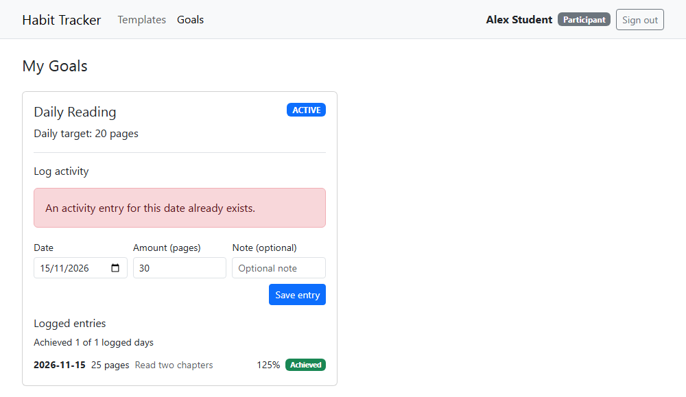

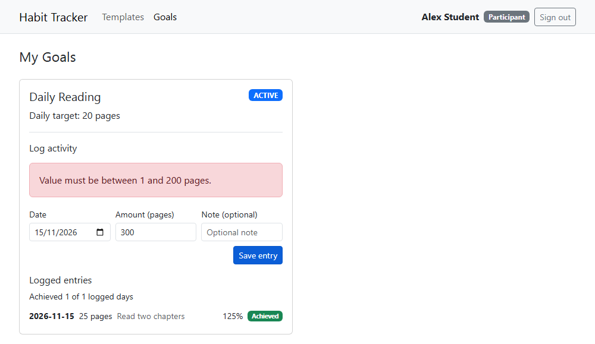

### Scenario 3 — Login/logout and forbidden role or ownership operations

| | |
|---|---|
| Features / AC | F-01: AC-02, AC-05, AC-04; F-05: AC-25, AC-26; F-03: AC-32 |
| Roles | Participant 1, Participant 2 (`participant2@example.test`), Program Manager (`manager@example.test`), no session |
| Steps | Wrong password; sign out and reuse the old session; participant 2 requests participant 1's goal 14 progress; manager requests goals and goal 14 progress; request without a session |
| Expected | 401 for wrong password, signed-out session and no session; 404 for another participant's goal (existence not revealed); 403 for the manager |
| Actual | As expected (screens 3a–3h). The API screens show the raw server response for that browser session — the protection is enforced by the backend, not by hiding UI controls |

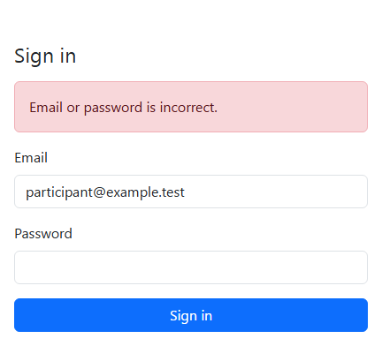

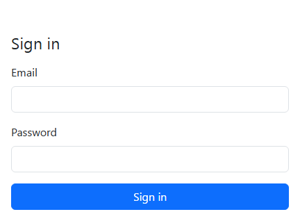

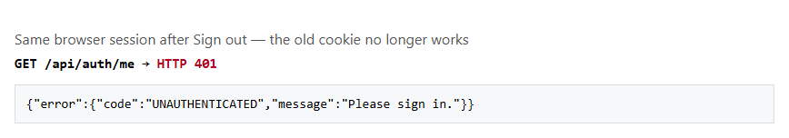

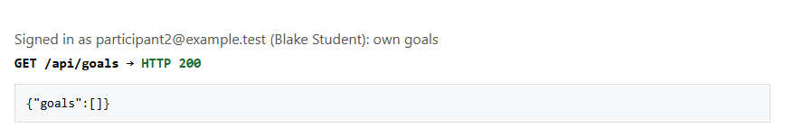

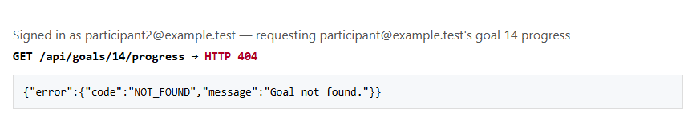

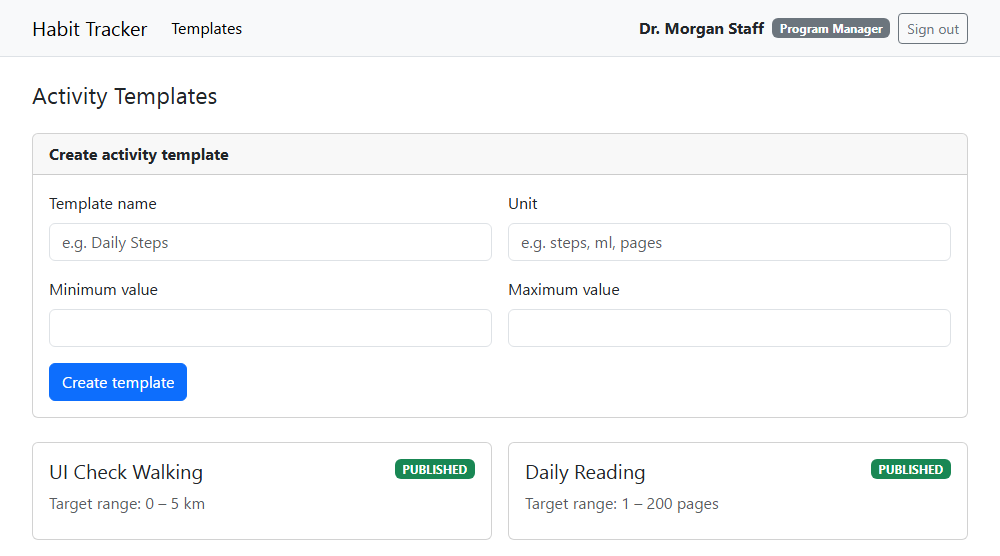

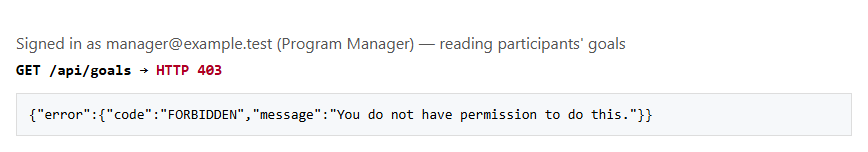

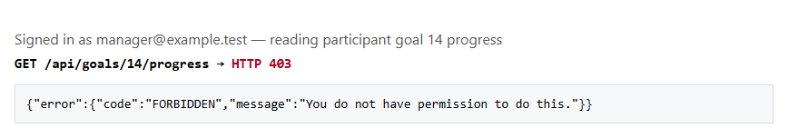

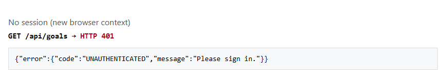

The same restrictions are verified by automated API tests: TEST-04 (all 11 protected endpoints without/with an unknown session), TEST-25 and TEST-26 (excerpt in F.4), TEST-32.

## F.3 Build and automated test results

Commands run on `2bafb18` (identical tree to the release `bfd125f`); full outputs are in `docs/evidence/release/`.

| Command | Files | Passed | Failed | Skipped |
|---|---|---|---|---|
| `npm run test:server` (Vitest + Supertest, real PostgreSQL) | 9 | 63 | 0 | 0 |
| `npm run test:client` (Vitest + React Testing Library) | 9 | 34 | 0 | 0 |
| `npm run test:e2e` (Playwright, Chromium) | 1 | 1 | 0 | 0 |
| `npm run test:restart` (NFR-04 stop/start check) | — | VERIFIED | — | — |
| `npm run build` (server `tsc`, client `tsc && vite build`) | — | OK | — | — |

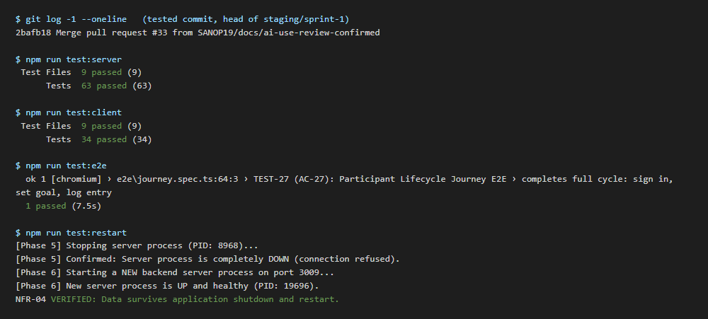

### AC → test → result (automated)

Generated from the test names in the recorded release run (`docs/evidence/release/`). Every Sprint 1 acceptance criterion maps to at least one automated test that passed.

<!-- AC_RESULTS_TABLE -->

**Manual / recorded checks** (they supplement, not replace, the automated tests): NFR-06 clean clone (F.1); NFR-08 secret check — no `.env` in Git history, no real credentials in tracked files, GitHub secret scanning on with 0 alerts (Part B); browser checks recorded in the reviews of PRs #26–#29; Scenario screens in F.2.

## F.4 Selected test excerpts and TDD evidence

### Excerpt 1 — Domain rule: back-dating window (BR-03, AC-20, NFR-09)

File `server/tests/logging.test.ts` (author Nara). The clock is fixed to Asia/Bangkok so the boundary is exact.

```ts
it("TEST-20 (AC-20): 6 days ago is accepted; 7 days ago is rejected with 422 DATE_TOO_OLD", async () => {
  clock.setMock("2026-11-14T12:00:00+07:00"); // Today is 2026-11-14

  const validPast = await postEntry(aCookie, aGoal.id, { entryDate: "2026-11-08", value: 20 });
  expect(validPast.status).toBe(201);

  const tooOld = await postEntry(aCookie, aGoal.id, { entryDate: "2026-11-07", value: 20 });
  expect(tooOld.status).toBe(422);
  expect(tooOld.body.error.code).toBe("DATE_TOO_OLD");

  const stored = await prisma.activityEntry.findMany({ where: { goalId: aGoal.id } });
  expect(stored).toHaveLength(1);
  expect(stored[0].entryDate).toBe("2026-11-08");
});
```

| TDD step | Commit | Result (from `docs/evidence/F-04/`) |
|---|---|---|
| Contract (AC-20, STS row) | `61f9b4c` 14 Nov 21:41 | — |
| Failing test committed | `38e843e` 14 Nov 21:43 | `× TEST-20 … AssertionError: expected 404 to be 201` — server 9 failed / 44 passed |
| Implementation | `2f3db9f` 14 Nov 21:46 | `✓ TEST-20` — server 53 passed |
| Review fix (midnight test TEST-19b added) | `3fd0426` 14 Nov 21:59 | `✓ TEST-20`, `✓ TEST-19b` — server 54 passed |
| Release run | `2bafb18` | `✓ TEST-20` — server 63 passed |

### Excerpt 2 — Ownership restriction: participant isolation (BR-05, AC-25)

File `server/tests/progress.test.ts` (author Nitithorn). The positive control makes the test fail before the endpoint exists — a plain "404" check would pass early because unknown routes also return 404.

```ts
it("TEST-25 (AC-25): a participant reads their own progress but gets 404 for another participant's goal, entries and progress", async () => {
  const own = await request(app).get(`/api/goals/${aGoalId}/progress`).set("Cookie", aCookie);
  expect(own.status).toBe(200); // positive control

  for (const path of [`/api/goals/${bGoalId}`, `/api/goals/${bGoalId}/entries`,
                      `/api/goals/${bGoalId}/progress`, "/api/goals/abc/progress"]) {
    const res = await request(app).get(path).set("Cookie", aCookie);
    expect(res.status, path).toBe(404);
    expect(res.body.error.code).toBe("NOT_FOUND");
    expect(res.text).not.toContain("77.7");           // B's value
    expect(res.text).not.toContain("B-private-note"); // B's note
  }
});
```

| TDD step | Commit | Result (from `docs/evidence/F-05/`) |
|---|---|---|
| Contract v1.0, then v1.1 adding the positive control | `e1e189e` 22:06, `c89ee18` 22:07 | — |
| Failing test committed | `6585113` 22:08 | `× TEST-25 … AssertionError: expected 404 to be 200` — server 7 failed / 56 passed |
| Implementation | `3cd6408` 22:11 | `✓ TEST-25` — server 63 passed |
| Release run | `2bafb18` | `✓ TEST-25` — server 63 passed |

Tests that passed *before* their implementation and are therefore **not** used as TDD evidence: TEST-23 and the manager case in F-04 (the route did not exist, so the generic 404/router-level 403 already matched), TEST-29 (regression check of the existing error handler), and the E2E red run (failed on a placeholder text).

## F.5 Engineering workflow and history

### Issue → PR chains

| | Chain 1 — F-04 Daily logging | Chain 2 — F-05 Progress and privacy |
|---|---|---|
| Issue | #20 (requirements FR-08, BR-01..04, NFR-09/10; AC-17..23, AC-28) | #21 (FR-09, BR-05, BR-07, NFR-05; AC-24..26, AC-29) |
| Contract | `docs/sprints/sprint-1/F-04-logging.md` | `docs/sprints/sprint-1/F-05-progress-privacy.md` |
| Branch | `feature/F-04-logging` → `staging/sprint-1` | `feature/F-05-progress-privacy` → `staging/sprint-1` |
| PR / author | #29 / Nara | #30 / Nitithorn |
| Reviewer and review | Nitithorn — **changes requested** 14:55 UTC: evidence files saved as UTF-16, NFR-09 tested only at noon (supplied a midnight probe), NFR-04 overstated; **approved** 15:05 UTC after re-running red/green, the midnight test and a browser check | Nara — **approved** 15:14 UTC after running both suites, re-seeding, checking participant 2 → 404 and the truncation rule |
| Integration | merged into staging as `0945644` | merged into staging as `9273884` |
| Release | PR #34 `staging/sprint-1` → `main`, approved by Nara (re-ran all suites on `2bafb18`), merged as `bfd125f`, tag `v0.1.0-sprint1` | same |

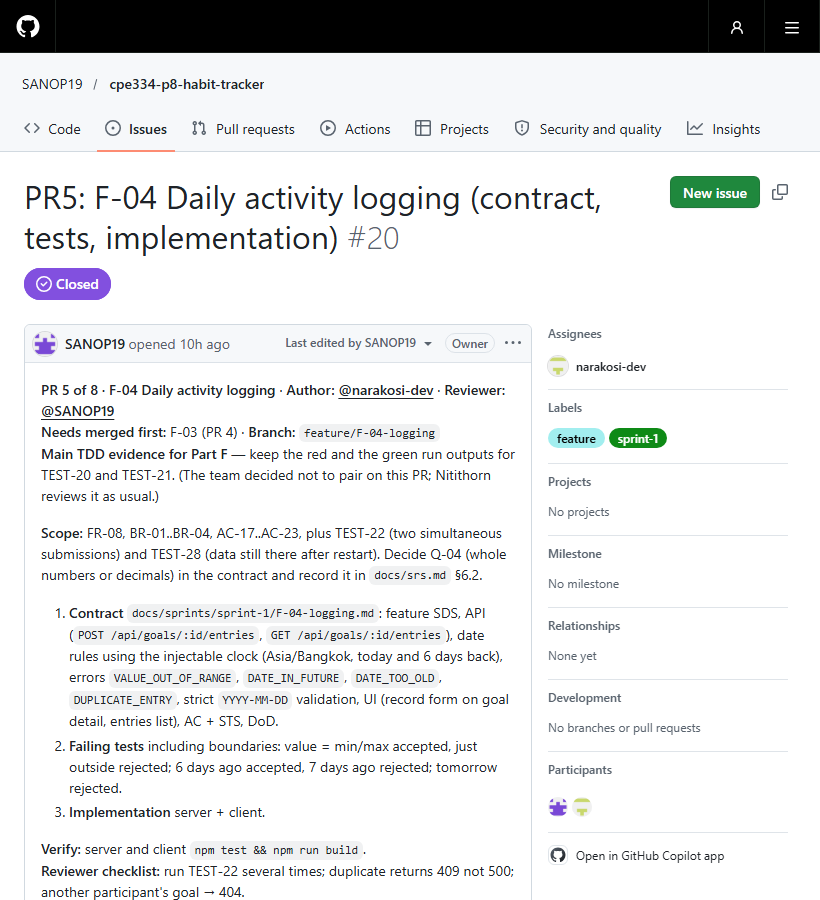

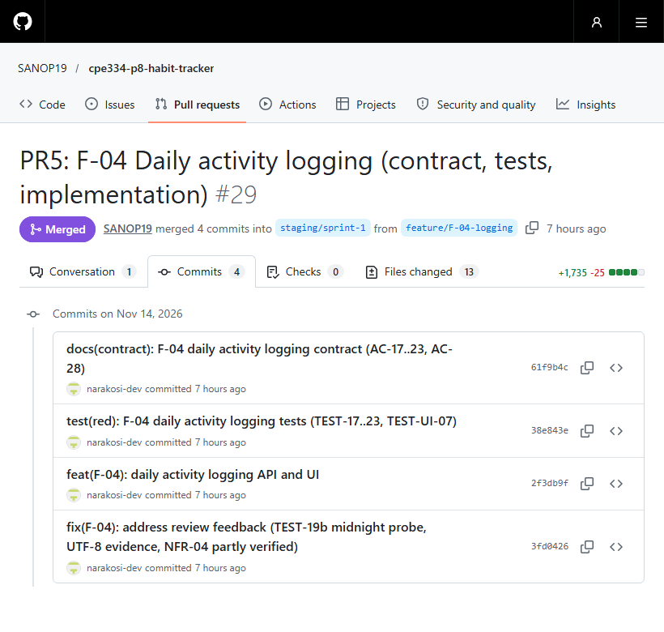

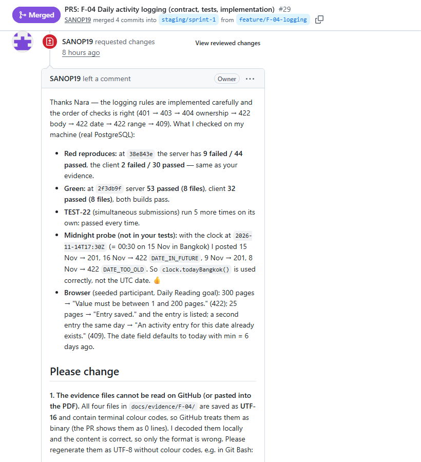

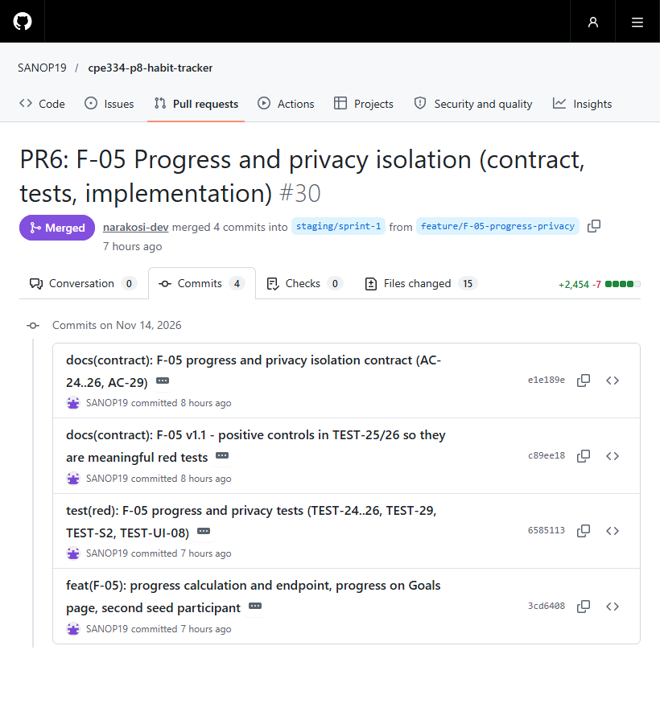

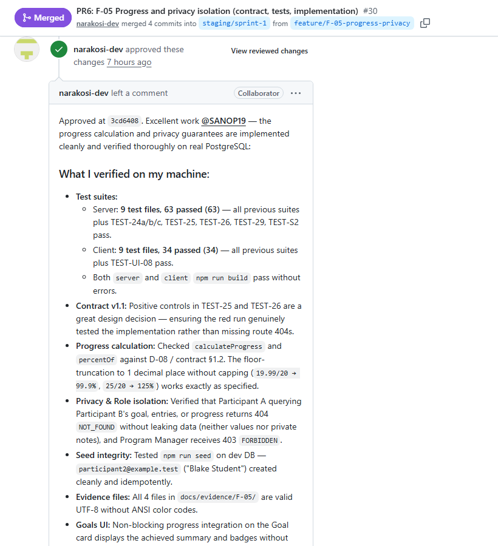

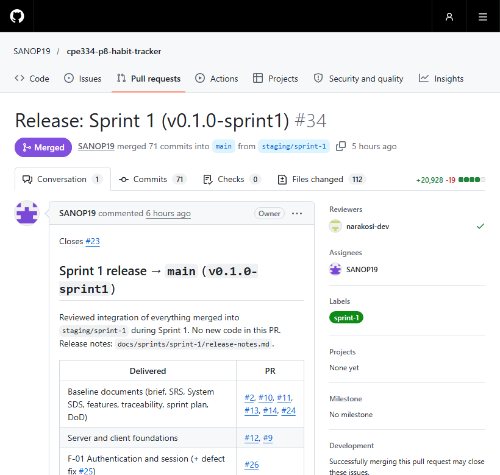

### History sequence (contract and test design before implementation)

| Time (14 Nov 2026, +07) | Commit | Author | Step |
|---|---|---|---|
| 21:41 | `61f9b4c` | Nara | F-04 contract (AC-17..23, AC-28, STS) |
| 21:43 | `38e843e` | Nara | F-04 failing tests |
| 21:46 | `2f3db9f` | Nara | F-04 implementation |
| 21:59 | `3fd0426` | Nara | F-04 review fixes |
| 22:05 | `0945644` | (merge) | PR #29 into staging, approved by Nitithorn |
| 22:06 | `e1e189e` | Nitithorn | F-05 contract v1.0 |
| 22:07 | `c89ee18` | Nitithorn | F-05 contract v1.1 (positive controls) |
| 22:08 | `6585113` | Nitithorn | F-05 failing tests |
| 22:11 | `3cd6408` | Nitithorn | F-05 implementation |
| 22:27 | `9273884` | (merge) | PR #30 into staging, approved by Nara |
| 23:35 | `bfd125f` | (merge) | Release PR #34 into main; tag `v0.1.0-sprint1` |

The same contract → `test(red)` → `feat` order was used for F-01 (#26), F-02 (#27) and F-03 (#28); their red and green outputs are in `docs/evidence/F-01..F-03/`.

### Final board status (project "CPE334 Habit Tracker Board")

All Sprint 1 Issues are **Done** and closed: #1, #3–#8 (parts P0–P4b), #16–#23 (PR1–PR8), #25 (defect). Release reference: tag `v0.1.0-sprint1` → `bfd125f` (PR #34). Board status below is the result of `gh project item-list` taken on 15 November 2026: all 26 board items are Done.

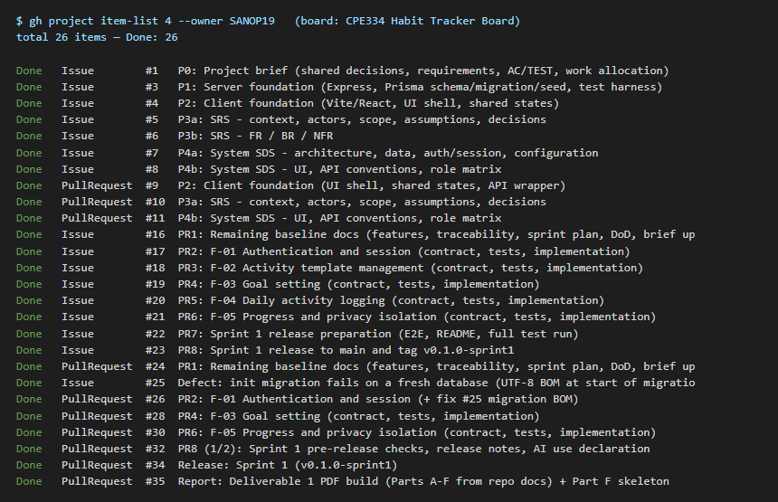

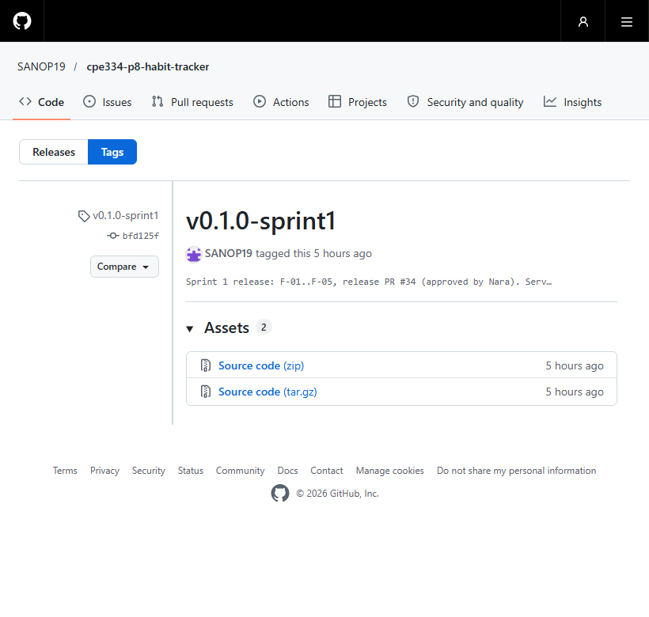

## F.6 Contribution

| Member | Authored (Issue/PR) | Reviewed | Can explain |
|---|---|---|---|
| Nitithorn Ketkaew | P0 brief (#2), P2 client foundation (#9), P3a SRS context (#10), P4b SDS UI/API/roles (#11), PR1 features/traceability/plan/DoD (#24), F-01 auth + defect #25 (#26), F-03 goals (#28), F-05 progress/privacy (#30), pre-release checks and AI declaration (#32, #33), release (#34), this report | P1 (#12), P3b (#13), P4a (#14), F-02 (#27), F-04 (#29), release prep (#31, three clean-clone runs) | Session lifecycle, role guard, goal rules, progress formula and privacy tests; release process |
| Nara Kosiyaporn | P1 server foundation (#12), P3b SRS FR/BR/NFR (#13), P4a SDS architecture/data/auth/config (#14), F-02 templates (#27), F-04 daily logging (#29), E2E + README + restart check (#31) | P0, P2, P3a, P4b, PR1, F-01, F-03, F-05, pre-release checks, release (#2, #9–#11, #24, #26, #28, #30, #32–#34) | Data model and constraints, test harness, date-window and duplicate rules, E2E journey, restart check |

Non-merge commits in the release: Nitithorn 24, Nara 22 (equal counts are not required). Every PR was reviewed by the other member; no author approved their own PR. AI use is declared at the end of this part.
